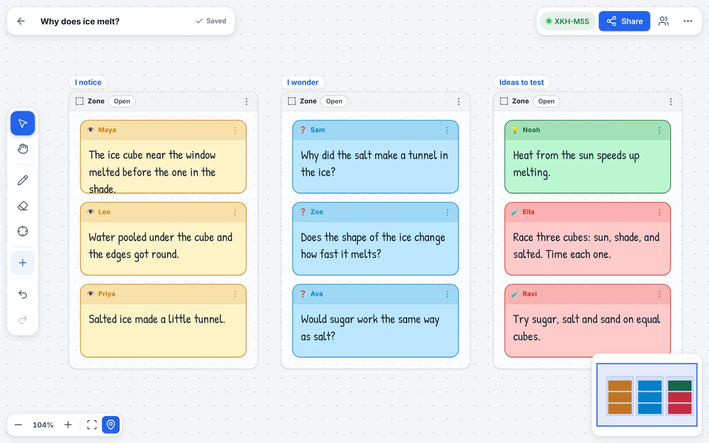

# InquiryDQB

**A free, private digital question board for the classroom.** Students join with a short code (no accounts), share notices, wonders and ideas from any device, and the teacher organises their thinking live on an infinite canvas.

InquiryDQB is a static website: HTML, CSS and vanilla JavaScript, with no build step and no server of its own. Teacher and students connect directly to each other with WebRTC (via [PeerJS](https://peerjs.com/)), and boards are saved in the teacher's browser.

**Live site:** <https://inquirydqb.io/>



## What it does

### Teacher console (`/Teacher/`)

- **Infinite canvas** with pan, zoom, minimap, smart snapping guides, multi-select, grouping, align / distribute, undo and redo.
- **Purposeful content:** Notice, Wonder, Idea and Test notes; zones that auto-arrange their notes; a Claim · Evidence · Reasoning builder; a shared class model; breakout rooms.
- **Live activities:** poll, live graph, spinner; vote, rank and discuss on any set of notes; five exit-ticket formats (short answer, rating, multiple choice, multi-select, learn / wonder).
- **Classroom control:** approve notes before they appear, pause or remove a student, hide names, class timer, co-host on a second device, lock or open the board.
- **Yours to keep:** boards autosave on the device; export as a board file (JSON), a picture (PNG) or a printable outline; text-only accessibility view; templates (See-Think-Wonder, K-W-L, Frayer, Venn, Four Corners, Compass Points) and your own.
- Desktop feels like a whiteboard app (tool rail, floating bars, docked class panel, keyboard shortcuts: press `?`). On phones it becomes a bottom-navigation app with sheets and a selection toolbar.

### Student app (`/Student/`)

- Join by typing the six-character code, scanning the QR code, or opening the join link. Pick an avatar and a first name.
- Board tab shows only what the teacher is running now; **My notes** keeps everything the student wrote, with delivery status (sending, on the board, waiting for the teacher, not added).
- Full-screen task pages for writing, sketching, polls, graphs, exit tickets and the shared model.
- Survives flaky Wi-Fi: reconnects automatically, queues notes while offline, restores drafts.
- Installable on a home screen (PWA); light and dark themes.

## Running it

It is a static site. Any web server works; WebRTC and IndexedDB need `http://localhost` or `https://`.

```bash
npm start            # serves the repo at http://localhost:8080/
```

Teacher: <http://localhost:8080/Teacher/> · Student: <http://localhost:8080/Student/>

Without Node: `python3 -m http.server 8080` in the repository root does the same job.

### Tests

The tests drive real Chromium windows (a teacher and several students) against a local PeerServer, so they never touch the public PeerJS cloud.

```bash
npm install
npx playwright install chromium
npm test
```

See [docs/ARCHITECTURE.md](docs/ARCHITECTURE.md) for what is covered.

### Connection service and school networks

Joining needs a small "introduction" service that lets two browsers find each other. By default InquiryDQB uses the free public PeerJS service (plus public STUN/TURN servers). They only ever see connection details such as IP addresses and the random class code, never boards, notes or names. If a school network blocks them, or you want to keep even that inside your own walls, run your own; see [docs/SELF_HOSTING.md](docs/SELF_HOSTING.md).

## Project layout

```
index.html, landing.css, landing.js   Landing page (join-by-code form, how it works, FAQ)
Teacher/                              Teacher console
  index.html  app.css  app.js         Boards, rendering, input, networking, activities
  shell*.js                           App chrome: rail, panel, sheets, home screen
Student/                              Student app (index.html, app.css, app.js)
shared/                               Design system and helpers used by all three pages
  ui.css  ui.js                       Tokens, components, sheets / dialogs / menus / toasts, history
  net.js                              Join codes, PeerJS options, error explanations
  icons.js                            Generated icon set (tools/build-icons.mjs)
vendor/  fonts/  icons/  assets/      Self-hosted libraries, fonts, app icons, landing images
sw.js                                 Service worker (offline start-up, instant updates)
tests/  tools/  docs/                 Test suite, dev tooling, documentation
```

## Privacy in one paragraph

No accounts, no analytics, and no third-party scripts or fonts (everything is self-hosted; the test suite checks that pages request nothing from other origins). Student names and notes travel from each student's device to the teacher's over encrypted WebRTC connections and are never stored on a server. Students never receive the whole board, only the activity the teacher launches. Boards live in the teacher's browser storage; students' own notes stay on their device. One caveat: by default WebRTC set-up uses public infrastructure (the PeerJS connection service, a Google STUN server, and PeerJS TURN servers that relay encrypted traffic when no direct path exists). They can see IP addresses and the class code but not the content, and all of them can be replaced; see [docs/SELF_HOSTING.md](docs/SELF_HOSTING.md).

## Contributing

Issues and pull requests are welcome. Keep it dependency-free at runtime, escape everything that arrives over the network (`DQBUI.esc`, `safeId`, `safeColor`, `safeImg`), and run `npm test` before opening a pull request.

## Licence

[MIT](LICENSE). Bundled third-party components keep their own licences (listed in the licence file).
